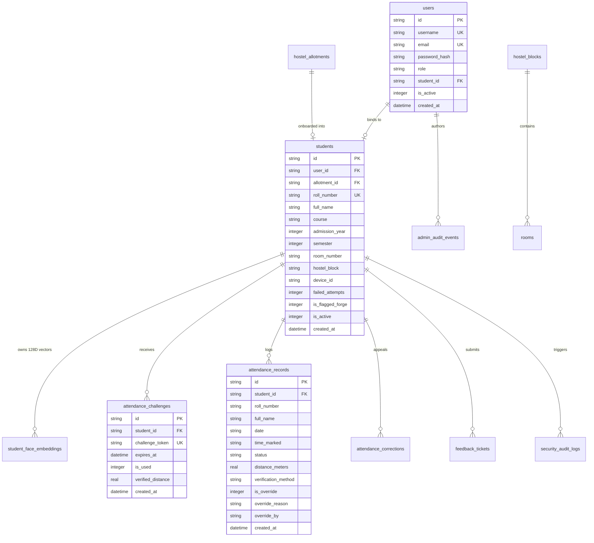

# Database Schema Specification: HostelGuard Enterprise

## 1. Engine Configuration & Concurrency Parameters

HostelGuard uses an embedded SQLite database configured for high-concurrency production deployments:
- **Database File**: `backend/data/hostel_attendance.sqlite`
- **Journal Mode**: `WAL` (Write-Ahead Logging). Permits concurrent reads alongside active writes.
- **Foreign Key Enforcement**: `ON` (Checked on every connection pool allocation).
- **Busy Timeout**: `5000 ms` (Mitigates SQLite busy/locked conditions during write surges).
- **Synchronous**: `NORMAL` (Optimal balance of durability and disk I/O performance in WAL mode).

---

## 2. Entity Relationship Diagram (ERD)



---

## 3. Table Catalog & Column Definitions

### 3.1 `users`
System accounts for Administrators, Wardens, and Registered Students.
| Column | Type | Constraints | Description |
|---|---|---|---|
| `id` | TEXT | PRIMARY KEY | UUID v4 |
| `username` | TEXT | UNIQUE, NOT NULL | Account handle (e.g. `admin`, `warden`, or student roll number) |
| `email` | TEXT | UNIQUE, NOT NULL | Contact email address |
| `password_hash` | TEXT | NOT NULL | Salted bcrypt hash |
| `role` | TEXT | NOT NULL | Enum: `'ADMIN'`, `'WARDEN'`, `'STUDENT'` |
| `student_id` | TEXT | FOREIGN KEY | References `students(id)` (NULL for staff/admins) |
| `is_active` | INTEGER | DEFAULT 1 | 1 = Active, 0 = Deactivated |
| `must_change_password` | INTEGER | DEFAULT 0 | Enforces password change on initial login |
| `created_at` | DATETIME | DEFAULT CURRENT_TIMESTAMP | UTC timestamp |

### 3.2 `hostel_blocks` & `rooms`
Physical facility layout.
| Column | Type | Constraints | Description |
|---|---|---|---|
| `id` | TEXT | PRIMARY KEY | UUID v4 |
| `block_name` | TEXT | UNIQUE, NOT NULL | e.g. `'Block A'`, `'Block B'` |
| `total_rooms` | INTEGER | DEFAULT 0 | Room capacity count |
| `warden_name` | TEXT | NULLABLE | Assigned supervisor |

### 3.3 `hostel_allotments`
Pre-allotment roster imported via administrative CSV/JSON.
| Column | Type | Constraints | Description |
|---|---|---|---|
| `id` | TEXT | PRIMARY KEY | UUID v4 |
| `roll_number` | TEXT | UNIQUE, NOT NULL | Pre-assigned institutional roll number |
| `full_name` | TEXT | NOT NULL | Official allotment name (enforces non-editable name rule) |
| `room_number` | TEXT | NOT NULL | Allocated room |
| `hostel_block` | TEXT | NOT NULL | Allocated hostel block |
| `is_registered` | INTEGER | DEFAULT 0 | 0 = Pending onboarding, 1 = Onboarded |

### 3.4 `students`
Authoritative registered student residents.
| Column | Type | Constraints | Description |
|---|---|---|---|
| `id` | TEXT | PRIMARY KEY | Format: `HSTL-{admission_year}-{roll}` |
| `user_id` | TEXT | FOREIGN KEY `users(id)` | Authentication user account |
| `allotment_id` | TEXT | FOREIGN KEY `hostel_allotments(id)` | Linked allotment reference |
| `roll_number` | TEXT | UNIQUE, NOT NULL | Student identity key |
| `full_name` | TEXT | NOT NULL | Student display name |
| `email` | TEXT | NULLABLE | Student email |
| `phone` | TEXT | NULLABLE | Contact telephone |
| `course` | TEXT | NOT NULL | Academic course (e.g. B.Tech Computer Science) |
| `admission_year` | INTEGER | NOT NULL | Year of admission (e.g. 2023) |
| `semester` | INTEGER | NOT NULL | Current semester (e.g. 4) |
| `room_number` | TEXT | NULLABLE | Assigned room |
| `hostel_block` | TEXT | NULLABLE | Assigned block |
| `device_id` | TEXT | NOT NULL | Registered hardware device signature |
| `device_model` | TEXT | NULLABLE | Client user-agent device summary |
| `is_active` | INTEGER | DEFAULT 1 | Resident status |
| `failed_attempts` | INTEGER | DEFAULT 0 | Active out-of-bounds strike counter (0 to 3) |
| `is_flagged_forge` | INTEGER | DEFAULT 0 | 1 = Account locked due to 3-strike Forge rule |

### 3.5 `student_face_embeddings`
Encrypted/protected mathematical biometric vector representations.
| Column | Type | Constraints | Description |
|---|---|---|---|
| `id` | TEXT | PRIMARY KEY | UUID v4 |
| `student_id` | TEXT | FOREIGN KEY `students(id)` | Linked student |
| `angle_label` | TEXT | NOT NULL | `'FRONT'`, `'LEFT_TILT'`, `'RIGHT_TILT'` |
| `embedding_vector` | TEXT | NOT NULL | JSON-encoded 128-D floating point array from OpenCV SFace |
| `quality_score` | REAL | DEFAULT 1.0 | Face clarity assessment |
| `liveness_score` | REAL | DEFAULT 1.0 | Laplacian variance measurement |

### 3.6 `attendance_challenges`
Single-use, short-lived tokens issued upon successful geofence validation.
| Column | Type | Constraints | Description |
|---|---|---|---|
| `id` | TEXT | PRIMARY KEY | UUID v4 |
| `student_id` | TEXT | FOREIGN KEY `students(id)` | Target student |
| `challenge_token` | TEXT | UNIQUE, NOT NULL | Single-use UUID token |
| `expires_at` | DATETIME | NOT NULL | Expiration timestamp (5-minute window) |
| `is_used` | INTEGER | DEFAULT 0 | 0 = Unused, 1 = Consumed (prevents token replay) |
| `verified_distance` | REAL | NULLABLE | Measured distance in meters |

### 3.7 `attendance_records`
Permanent roll call attendance log.
| Column | Type | Constraints | Description |
|---|---|---|---|
| `id` | TEXT | PRIMARY KEY | UUID v4 |
| `student_id` | TEXT | FOREIGN KEY `students(id)` | Resident reference |
| `roll_number` | TEXT | NOT NULL | Fast lookup roll number |
| `full_name` | TEXT | NOT NULL | Denormalized student name for fast reporting |
| `date` | TEXT | NOT NULL | Format: `YYYY-MM-DD` |
| `time_marked` | TEXT | NOT NULL | Format: `HH:MM:SS` |
| `status` | TEXT | NOT NULL | Enum: `'PRESENT'`, `'ABSENT'`, `'EXCUSED'`, `'OVERRIDDEN'` |
| `distance_meters` | REAL | NULLABLE | Haversine distance at check-in |
| `accuracy` | REAL | NULLABLE | Device GPS reported accuracy (m) |
| `verification_method` | TEXT | NOT NULL | e.g. `'SFace 128D Biometric'`, `'Admin Override'` |
| `is_override` | INTEGER | DEFAULT 0 | 1 = Manually overridden |
| `override_reason` | TEXT | NULLABLE | Mandatory administrative justification |
| `override_by` | TEXT | NULLABLE | Username of administrator |

### 3.8 `admin_audit_events` & `security_audit_logs`
Cryptographically traceable audit journals.
| Column | Type | Constraints | Description |
|---|---|---|---|
| `id` | TEXT | PRIMARY KEY | UUID v4 |
| `user_id` | TEXT | NULLABLE | Acting user ID |
| `username` | TEXT | NOT NULL | Administrator/Warden username |
| `action` | TEXT | NOT NULL | e.g. `'ATTENDANCE_OVERRIDE'`, `'STRIKE_COUNTER_RESET'` |
| `target_entity` | TEXT | NULLABLE | Target type (`STUDENT`, `ROSTER`, etc.) |
| `target_id` | TEXT | NULLABLE | Target primary key |
| `details` | TEXT | NOT NULL | Detailed action narrative and parameters |
| `ip_address` | TEXT | NULLABLE | Request remote client IP |
| `created_at` | DATETIME | DEFAULT CURRENT_TIMESTAMP | Immutable event timestamp |

---

## 4. Performance Indexes

```sql
CREATE INDEX IF NOT EXISTS idx_attendance_date ON attendance_records(date);
CREATE INDEX IF NOT EXISTS idx_attendance_student ON attendance_records(student_id);
CREATE INDEX IF NOT EXISTS idx_students_roll ON students(roll_number);
CREATE INDEX IF NOT EXISTS idx_users_username ON users(username);
CREATE INDEX IF NOT EXISTS idx_challenges_token ON attendance_challenges(challenge_token);
CREATE INDEX IF NOT EXISTS idx_audit_created ON admin_audit_events(created_at);
CREATE INDEX IF NOT EXISTS idx_security_created ON security_audit_logs(created_at);
CREATE INDEX IF NOT EXISTS idx_corrections_status ON attendance_corrections(status);
```
