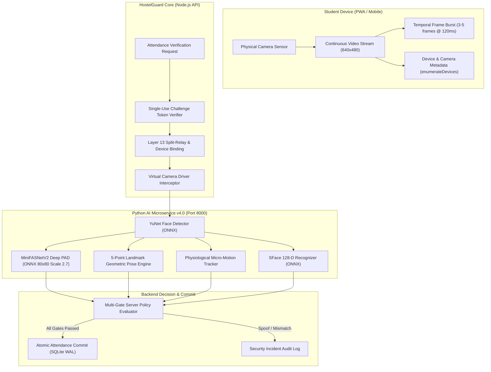

# HostelGuard Enterprise v4.0: Facial Anti-Spoofing & Active Liveness Architecture
**Document Version:** 4.0.0 (Production Engineering Release)  
**Classification:** Confidential – Institutional Biometric Security Standard  
**Target Platform:** Edge & Local Deployment (Python FastAPI + Node.js Express + SQLite WAL + Web/PWA)

---

## 1. Executive Summary

HostelGuard Enterprise v4.0 is an advanced, 100% Free and Open Source (FOSS) biometric authentication and Presentation Attack Detection (PAD) subsystem. It replaces single-frame, handcrafted heuristic filters (Laplacian variance, 2D FFT moiré thresholds, and skin chrominance checks) with a multi-layered, deep-learning presentation-attack detection architecture running locally on edge CPUs without recurring cloud API fees or external data leakage.

The v4.0 engine was engineered specifically to neutralize:
1. **Printed Photographs:** High-resolution matte and glossy paper photographs.
2. **High-PPI Digital Screens:** OLED, AMOLED, and Retina displays on smartphones, tablets, and laptops.
3. **Pre-recorded Video Replay Attacks:** Video playback of genuine students displayed on external monitors.
4. **Software Video Injection & Virtual Cameras:** Synthetic DirectShow/MediaStream injection (e.g. OBS Virtual Camera, ManyCam, v4l2loopback).
5. **Split-Relay Attacks:** Remote proxy verification across separate physical locations.

---

## 2. System Architecture & Component Topology

---

## 3. Detailed Component Specifications

### 3.1 Primary Deep-Learning PAD: MiniFASNetV2
- **Model Architecture:** MiniFASNetV2-SE (Pruned MobileFaceNet with Squeeze-and-Excitation blocks, optimized for Fourier spatial attack supervision).
- **Model Format & Size:** ONNX Runtime / `cv2.dnn` (1,743,581 bytes / ~1.74 MB).
- **Input Geometry:** `(1, 3, 80, 80)` tensor in BGR format, normalized to `[0.0, 1.0]`.
- **Context Scaling (2.7x Bounding Box Expansion):**
  Instead of tightly cropping only the facial features, the bounding box coordinates are expanded by a multiplier of $2.7\times$:
  $$\Delta W = W \times \frac{2.7 - 1}{2}, \quad \Delta H = H \times \frac{2.7 - 1}{2}$$
  $$X_1 = \max(0, X - \Delta W), \quad Y_1 = \max(0, Y - \Delta H)$$
  $$X_2 = \min(W_{\text{src}}, X + W + \Delta W), \quad Y_2 = \min(H_{\text{src}}, Y + H + \Delta H)$$
  This context captures bezel edges, display borders, ambient specular reflections, and paper boundaries that reveal presentation attacks.
- **Output Softmax Probabilities:**
  - $P_0$: 2D Paper Print Attack probability.
  - $P_1$: Bona Fide / Live Human Face probability.
  - $P_2$: 2D Replay / Digital Screen Attack probability.
- **Decision Threshold:** Genuine live pass requires $P_1 \ge 0.55$. Attacks where $P_0 + P_2 > 0.45$ fail closed immediately.

### 3.2 Server-Issued Active Liveness Challenge Engine
- **Session Binding:** Every location verification generates a unique, single-use active challenge persisted in `attendance_challenges.active_challenge`.
- **Challenge Nonce Pool:** `['HOLD_STILL', 'TURN_LEFT', 'TURN_RIGHT', 'NOD_DOWN', 'TILT_UP']`.
- **Geometric 5-Point Landmark Pose Estimation:**
  Using the 5 facial landmarks output by OpenCV YuNet ($RE, LE, NT, RC, LC$):
  - **Horizontal Yaw Ratio:**
    $$\text{Yaw Ratio} = \frac{(NT_x - RE_x) - (LE_x - NT_x)}{(NT_x - RE_x) + (LE_x - NT_x) + 10^{-6}}$$
    - Head turned left: $\text{Yaw Ratio} < -0.20$
    - Head turned right: $\text{Yaw Ratio} > +0.20$
    - Head centered: $\text{Yaw Ratio} \in [-0.18, +0.18]$
  - **Vertical Pitch Ratio:**
    $$\text{Pitch Ratio} = \frac{NT_y - \text{Eye}_y}{\text{Mouth}_y - NT_y + 10^{-6}}$$
    - Chin down (nod): $\text{Pitch Ratio} < 0.70$
    - Chin up (tilt): $\text{Pitch Ratio} > 1.35$
- **Unpredictability:** Because the active challenge is selected by the server *after* GPS location verification, pre-recorded replay videos or static photos cannot dynamically respond to the server's command.

### 3.3 Multi-Frame Temporal Continuity Tracker
- **Temporal Burst:** Frontend client captures 3 to 5 continuous frames spaced $\sim 120\text{ ms}$ apart.
- **Physiological Micro-Motion:**
  $$\bar{\Delta}_{\text{landmarks}} = \frac{1}{N-1} \sum_{i=1}^{N-1} \frac{1}{10} \sum_{k=1}^{10} |p_{i, k} - p_{i-1, k}|$$
  - $\bar{\Delta} < 0.25\text{ px}$: Completely static image detected (flagged as static photo replay).
  - $\bar{\Delta} > 85.0\text{ px}$: Unnatural video splice / camera injection jump detected.
  - $0.25 \le \bar{\Delta} \le 85.0\text{ px}$: Natural human micro-motion confirmed.

### 3.4 Camera Provenance & Virtual Camera Shield
- In `StudentPortal.jsx`, `navigator.mediaDevices.enumerateDevices()` audits video input devices.
- Virtual camera signatures (`OBS Virtual Camera`, `ManyCam`, `v4l2loopback`, `Virtual`, `Camo`, `SplitCam`, `Snap Camera`) are detected in client telemetry.
- When an untrusted driver is present, the backend rejects check-in with `403 VIRTUAL_CAMERA_BLOCKED` and records a high-risk security audit log (`L10_VIRTUAL_CAMERA_DRIVER`).

---

## 4. Operational Invariant Guarantees

1. **Fail-Closed Guarantee:** If the AI microservice is unreachable, models cannot be loaded, or an unhandled exception occurs, the system **never** marks attendance as `PRESENT`.
2. **Server-Authoritative Decisions:** Client-supplied flags (e.g. `is_live = true`, `spoof_passed = true`) are strictly ignored. The backend independently feeds raw camera frames to the local Python AI microservice.
3. **No Replay Window:** Challenge tokens expire after 90 seconds and can be consumed exactly once using an atomic SQL condition: `UPDATE attendance_challenges SET is_used = 1 WHERE id = ? AND is_used = 0`.
4. **Fair Disciplinary Routing:** Lighting anomalies or low-confidence face detections trigger a `RETRY` or Warden Manual Review rather than an immediate disciplinary lockout strike.

