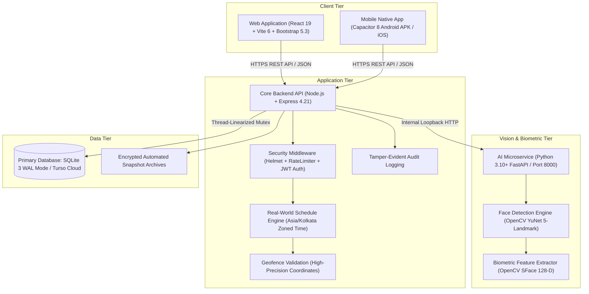
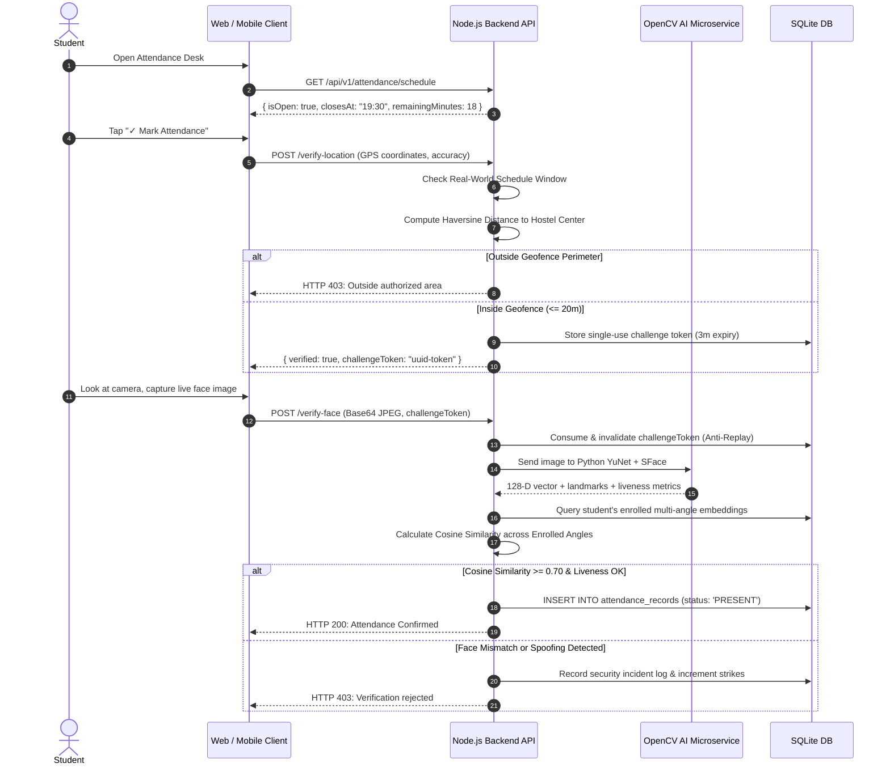

# HostelGuard Enterprise: Current System Architecture

> **Authoritative Specification — Production Release v2.4**  
> *Last Updated: October 2026*  
> *Note: This document represents the current, verified codebase in active production. Historical candidates or speculative architectures (such as Next.js, NestJS, PostgreSQL, Prisma, MediaPipe, or 512-D ArcFace) have been benchmarked, evaluated, and decommissioned in favor of the production-tested stack documented below.*

---

## 1. High-Level System Architecture

---

## 2. Technical Stack Breakdown

| Subsystem | Production Technology | Version | Purpose & Rationale |
| :--- | :--- | :--- | :--- |
| **Frontend Framework** | React | `^19.0.0` | High-performance Single Page Application with optimized hooks and state management. |
| **Build Tool** | Vite | `^6.2.0` | Sub-second HMR and production bundle optimization with manual chunk splitting. |
| **CSS Framework** | Bootstrap | `^5.3.8` | Institutional, accessible, consistent UI system paired with custom modern utility styling. |
| **Iconography** | Lucide React | `^1.16.0` | Lightweight, consistent SVG icon set for clear navigation. |
| **Interactive Mapping** | Leaflet | `^1.9.4` | Open-source geospatial map rendering with zero vendor lock-in or recurring API costs. |
| **Data Visualization** | Chart.js + react-chartjs-2 | `^4.5.1` / `^5.3.1` | Responsive attendance trend visualizations and block occupancy distribution charts. |
| **Mobile Runtime** | Capacitor | `^8.5.3` | Direct native hardware bindings to Android Camera2 and Geolocation APIs. |
| **Backend Core** | Node.js + Express | `v20+` / `^4.21.2` | Event-driven REST API server handling authentication, validation, and data routing. |
| **Security Layer** | Helmet + express-rate-limit | `^8.3.0` / `^8.7.1` | HTTP security headers, CORS isolation, and brute-force IP rate limiting. |
| **Data Layer** | SQLite 3 (WAL) / Turso | `^5.1.7` / `^0.18.0` | Atomic local file persistence with Write-Ahead Logging (`WAL`) or optional Turso Cloud syncing. |
| **AI Biometric Service**| Python + OpenCV + FastAPI | Python 3.10+ / OpenCV 4.8+ | Dedicated microservice running YuNet (detection) and SFace (128-D embedding extraction). |

---

## 3. Database Schema (17 Authoritative Tables)

The active production database uses SQLite with Write-Ahead Logging (`PRAGMA journal_mode = WAL`), foreign keys enabled, and an in-process transaction mutex that linearizes concurrent transactions during peak 7:00 PM roll-call spikes.

1. **`users`**: Master authentication credentials (`username`, `email`, `password_hash`, `role: ADMIN | WARDEN | STUDENT`, `is_active`, `must_change_password`).
2. **`hostel_blocks`**: Campus residential buildings (`block_name`, `total_rooms`, `warden_name`).
3. **`rooms`**: Individual rooms per block (`block_id`, `room_number`, `capacity`, `occupied`).
4. **`hostel_allotments`**: Official pre-enrollment registry (`roll_number`, `full_name`, `room_number`, `hostel_block`, `is_registered`).
5. **`students`**: Registered student profiles (`roll_number`, `full_name`, `course`, `semester`, `device_id`, `failed_attempts`, `is_flagged_forge`).
6. **`student_face_embeddings`**: Multi-angle 128-D vectors (`angle_label: FRONT | LEFT | RIGHT | SMILE`, `embedding_vector`, `quality_score`, `liveness_score`).
7. **`geofence_configs`**: Geofence coordinate boundary (`latitude`, `longitude`, `radius_meters`, `is_active`).
8. **`attendance_challenges`**: Ephemeral single-use tokens preventing replay attacks (`challenge_token`, `expires_at`, `is_used`, `verified_distance`).
9. **`attendance_records`**: Roll-call marks (`date`, `time_marked`, `status: PRESENT | ABSENT | LATE | EXCUSED`, `similarity_score`, `liveness_score`, `override_reason`).
10. **`attendance_corrections`**: Student appeal tickets (`original_status`, `requested_status`, `reason`, `status: PENDING | APPROVED | REJECTED`, `resolution_note`).
11. **`security_audit_logs`**: Intrusion and spoofing incident logs (`incident_type: GPS_SPOOF | FACE_MISMATCH | TELEPORTATION`, `calculated_distance`, `details`, `ip_address`).
12. **`admin_audit_events`**: Immutable audit logs of administrative actions (`user_id`, `username`, `action`, `target_type`, `details`, `ip_address`).
13. **`feedback_tickets`**: Student support and grievance desk (`category: ATTENDANCE | HARDWARE | GEOFENCE | ROOM | GENERAL`, `subject`, `message`, `status`).
14. **`password_reset_otps`**: 6-digit OTP delivery records for SMS/Email password recovery (`otp_code`, `destination`, `expires_at`, `attempts`).
15. **`refresh_tokens`**: Rotating session tokens for secure persistent login.
16. **`student_registered_devices`**: Hardware fingerprint binding records (`device_id`, `device_model`, `browser_ua`, `is_active`).
17. **`attendance_schedule_configs` & `attendance_schedule_overrides`**:
    * Global schedule config (`default_start_time: 19:00`, `default_end_time: 19:30`, `is_enabled`, `timezone`).
    * Date-specific overrides (`override_date`, `title`, `start_time`, `end_time`, `is_holiday`, `notes`).

---

## 4. Authentication, Authorization & RBAC

The system employs a multi-tiered security and authentication architecture:
* **Access Tokens**: Short-lived JsonWebTokens (15-minute expiry) signed with HMAC-SHA256.
* **Refresh Tokens**: Cryptographic, database-backed refresh tokens with device binding and rotation upon renewal.
* **Role-Based Access Control (RBAC)**:
  * `ADMIN`: Master oversight, roster enrollment, geofence calibration, timing management, security strike unlocking, data purges, and system diagnostics.
  * `WARDEN`: Hostel block supervision, roll-call monitoring, live absentee inspection, student appeal review, and emergency calling.
  * `STUDENT`: Attendance check-in, personal attendance history, appeal submissions, and grievance ticketing.
* **Account Recovery**: Dual verification channels via 6-digit cryptographic OTPs delivered to verified Email or SMS phone numbers.

---

## 5. Attendance Verification & Security Pipeline

### Anti-Fraud & 3-Strike Security Protocol
* **Presentation Attack Defenses (PAD)**: Active angle calibration (frontal, left 30°, right 30°, dynamic expression) prevents static photo/replay presentation attacks.
* **Teleportation & Mock-Location Defense**: Verifies distance variance over time. Locations indicating unnatural speeds (> 100 km/h between check-ins) are blocked.
* **3-Strike Lockout**: Three consecutive failed verifications lock the account. Unlocking requires administrator review with mandatory documented audit justification.

---

## 6. Real-World Schedule Engine

* **Authoritative Server Clock**: Attendance windows are computed against real-world standard time (`Asia/Kolkata` timezone by default).
* **Default Window**: Nightly roll-call from `19:00` to `19:30` (7:00 PM – 7:30 PM).
* **Date-Specific Delays & Events**: Admins can override timing on specific dates (e.g. `20:30` – `21:30` for cultural feasts, sports festivals, or examinations).
* **Holiday Exemption Management**: Bulk upload of holiday schedules via Excel (`.xlsx`), CSV, or JSON automatically exempts roll-call requirements.

---

## 7. Data Hygiene & Governance

* **Individual Deletion**: Every data desk (corrections, incident alerts, audit logs, grievance tickets, attendance marks) provides individual row deletion with audit tracking.
* **Single-Click "Clear All"**: Dedicated bulk-purge workflows with item count confirmation dialogs prevent database bloat while preserving active rosters.
* **Automated Backups**: Built-in snapshot archiver generating encrypted `.sqlite` backup archives stored in `backend/data/backups/`.
